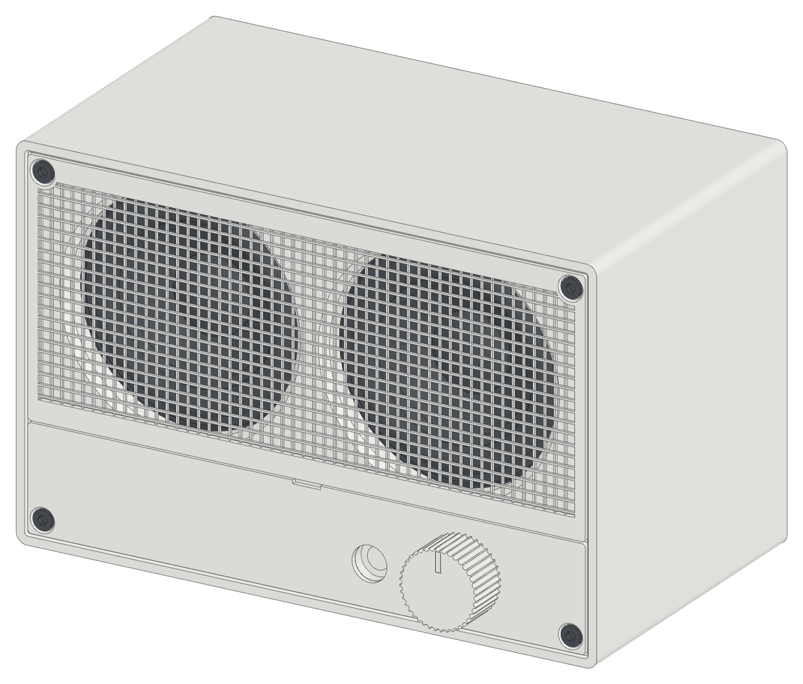

# Mini

<picture>
  <source media="(prefers-color-scheme: dark)" srcset="docs/lineart/img/hero-dark.png">
  
</picture>

A Bluetooth desk speaker that you print in three colors of PLA. Two Dayton Audio PC68-4
drivers and a ZK-502C Bluetooth amplifier sit in a sealed box of 166 × 108 × 94 mm. The
grille and the control strip snap on over four flush socket head screws.

- Website: https://beetlebugorg.github.io/mini/
- Spec sheet and build steps: [docs/Bluespeaker-Mini-Specs.pdf](docs/Bluespeaker-Mini-Specs.pdf)
- Drawings, 12 sheets: [docs/Bluespeaker-Mini-Drawings.pdf](docs/Bluespeaker-Mini-Drawings.pdf)
- Engineering report: [docs/Bluespeaker-Mini-Engineering-Report.pdf](docs/Bluespeaker-Mini-Engineering-Report.pdf)
- Design notes: [docs/MINI.md](docs/MINI.md)

## Build the files

1. `uv run cad/mini_report.py --step` writes the STEP parts.
2. `docs/lineart/build.sh` writes the line-art images and the spec sheet PDF.
3. `uv run cad/mini_drawings.py` writes the drawing sheets.
4. `uv run --with pymupdf cad/mini_report.py --pdf` writes the engineering report.
