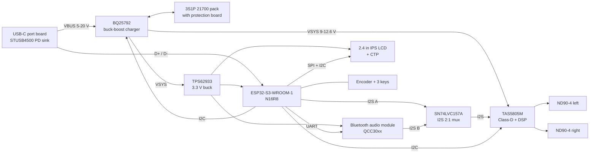

# Bluespeaker — design document

Revision 0.3 · 2026-10-07 · Status: concept, CAD model with fasteners · Assembly: `docs/ASSEMBLY.md`

## 1. Summary

Bluespeaker is a portable stereo speaker with a small touch LCD. It is a
Spotify Connect target on Wi-Fi and a Bluetooth speaker for any phone. The
screen shows album art, playlists, and the queue. The shell copies the Braun
style of the 1970s: an off-white box, a grid of round holes, one rotary knob,
and three dome keys.

| Item | Value |
|---|---|
| Outside size | 260 W × 165 H × 120 D mm |
| Drivers | 2× Dayton Audio ND90-4 (3.5", 4 Ω) |
| Bass | 2× Dayton Audio ND90-PR passive radiators, rear |
| Amplifier | TI TAS5805M, stereo Class-D with DSP, about 2× 15 W |
| Main controller | ESP32-S3-WROOM-1-N16R8 (Wi-Fi, UI, Spotify Connect) |
| Bluetooth | Separate Bluetooth audio module (AAC, aptX) |
| Display | 2.4" IPS, 320 × 240, capacitive touch |
| Battery | 3S1P Li-ion stick pack, 3× 21700 cells in line, about 50 Wh |
| Charge | USB-C PD, 20 V, up to 60 W |
| Run time | About 12 h at medium volume, about 5 h at high volume |
| Shell | FDM (PETG or ASA) or resin, painted matt off-white |

## 2. Requirements

1. The speaker plays Spotify through Spotify Connect over Wi-Fi.
2. The speaker plays any source through Bluetooth A2DP.
3. The LCD shows album art, title, artist, and progress for the active source.
4. The LCD lets the user browse playlists and start playback.
5. The knob sets volume. A push on the knob turns the speaker on and off.
6. The battery gives at least 8 h at medium volume.
7. One USB-C port charges the battery, runs the speaker, and flashes firmware.
8. All shell parts print on a 256 × 256 mm FDM bed or split for a resin printer.
9. One custom 4-layer PCB holds all electronics except the USB-C port board.

## 3. Changes from the first concept

- **Battery is 3S, not 2S.** A 2S pack gives a supply of 6–8.4 V. That
  limits the amplifier to about 2× 6 W into 4 Ω. A 3S pack gives 9–12.6 V and
  about 2× 15 W. This matches the 20 W rating of the ND90-4.
- **Size is 260 × 165 mm, not 240 × 130 mm.** The ND90-4 frame is 103.5 mm.
  The front needs 105 mm for the drivers and 52 mm for the control strip.
- **The radiators are low and the drivers are high.** The drivers and the
  radiators are each about 61 mm deep. In a 120 mm deep shell they collide
  if they are at the same height. The drivers are at Z = 108.5 mm and the
  radiators are at Z = 60 mm.
- **The drivers sit on 4 mm spacer frames.** The Dayton STEP model shows
  that the surround rises 6.1 mm in front of the frame. Without a spacer, the
  surround is 0.9 mm from the grille. With the spacer, the gap is 4.9 mm.
  The radiators sit on 3 mm frames and are at Z = 56 mm.
- **The ESP32-S3 is at the right end of the PCB.** Its antenna points to +X,
  past the encoder. At the left end, the LCD metal frame was in front of the
  antenna. The Bluetooth module is left of centre, with its antenna at the
  top edge of the PCB.
- **The front is one module.** The bay wall screws to the baffle with three
  tabs and holds the battery in three saddles. The baffle, LCD, PCB, bay
  wall, and battery slide into the sleeve together. No screws go through the
  bottom.
- **The battery is a stick pack in the electronics bay.** The three cells are
  in one line (211 × 21 × 21 mm). The pack sits behind the main PCB, below the
  bay shelf. A flat pack does not fit with the low radiators.

## 4. System architecture



### 4.1 Why two radio chips

The ESP32-S3 has Wi-Fi and Bluetooth LE. It has no Bluetooth Classic, so it
cannot receive A2DP audio. A separate Bluetooth module does A2DP and AVRCP.
The ESP32-S3 controls the module over UART.

An ESP32 with Bluetooth Classic can do both jobs on one chip. It cannot run
Wi-Fi audio, A2DP, and an LVGL UI together with good stability. It also
supports only the SBC codec. The two-chip design costs about 10 USD more and
gives AAC for iPhones and aptX for Android.

### 4.2 Audio path

- **Spotify:** cspot runs on the ESP32-S3. It receives Ogg Vorbis at
  320 kbit/s, decodes it, and sends 44.1 kHz PCM on I2S port A.
- **Bluetooth:** the module decodes SBC, AAC, or aptX. It sends PCM on I2S
  port B as I2S master.
- **Source select:** an SN74LVC157A mux connects one I2S bus (BCLK, LRCLK,
  DATA) to the amplifier. The ESP32-S3 sets the select pin. The amplifier
  mutes, re-locks to the new clock, and unmutes.
- **DSP:** the TAS5805M applies the driver EQ, a bass shelf, a dynamic range
  limiter, and the volume. The ESP32-S3 loads the coefficients over I2C.

Spotify lossless (FLAC) is not available through cspot. Vorbis at 320 kbit/s
is the target quality.

## 5. Electronics

### 5.1 Main parts

| Function | Part | Notes |
|---|---|---|
| MCU | ESP32-S3-WROOM-1-N16R8 | 16 MB flash, 8 MB octal PSRAM. cspot and LVGL need the PSRAM. |
| Bluetooth | Feasycom FSC-BT1026 series (QCC3034) | SBC, AAC, aptX. UART AT control, I2S out. Alternative: ESP32-WROOM-32E with open firmware, SBC only. |
| Amplifier | TI TAS5805M | PVDD 4.5–26.4 V, I2S slave, I2C control, built-in DSP. Ferrite-bead output filter. |
| I2S mux | SN74LVC157A | Quad 2:1 mux. Three channels in use. |
| Charger | TI BQ25792 | 1–4S buck-boost, 5 A, integrated FETs, NVDC power path, ADC for VBAT and IBAT. |
| USB-C PD | ST STUSB4500 | Autonomous PD sink with NVM. It works with a dead battery and no firmware. Requests 20 V, falls back to 15, 9, 5 V. |
| 3.3 V rail | TI TPS62933 | 3.8–30 V in, 3 A, 12 µA quiescent current. |
| LCD | 2.4" IPS 320 × 240, ST7789 or ILI9341, FT6336U touch | SPI at 40–80 MHz, I2C touch. |
| Input | EC11 encoder with push, 3× 6 mm tact switches | Keys sit under printed dome caps. |
| Battery | 3× Molicel P45B 21700, 3S1P stick pack (cells in line) with protection board and 10 kΩ NTC | Buy a built pack. Do not build the protection circuit on the main PCB. |

### 5.2 Power budget

| Load | Medium volume | High volume |
|---|---|---|
| Amplifier output (average) | 2.0 W | 7.0 W |
| Amplifier losses and idle | 0.5 W | 1.2 W |
| ESP32-S3, Wi-Fi streaming | 0.5 W | 0.5 W |
| LCD backlight (dims after 30 s) | 0.2 W | 0.2 W |
| Bluetooth module, buck losses | 0.2 W | 0.2 W |
| **Total** | **3.4 W** | **9.1 W** |
| **Run time from 45 Wh usable** | **about 13 h** | **about 5 h** |

### 5.3 Power states

1. **Ship mode:** the BQ25792 disconnects the battery. A USB-C connection
   wakes it. Use this state for storage and transport.
2. **Off:** the 3.3 V buck stays on. The ESP32-S3 is in deep sleep. The
   amplifier, the Bluetooth module, and the LCD have no power. Total current
   is below 50 µA, so the battery loses less than 1 % per week.
3. **On:** all parts have power.

A push on the knob wakes the ESP32-S3 from "off". A 3 s push turns it off. A
15 s push with USB-C disconnected sets ship mode.

### 5.4 PCB

- **Main board:** 4 layers (signal, GND, power, signal), 1.6 mm, about
  220 × 46 mm. It mounts vertically behind the control strip.
  - Front side: LCD FPC connector, encoder, three keys.
  - Rear side: all other parts.
- **Port board:** 2 layers, about 25 × 15 mm. It holds the USB-C socket, the
  STUSB4500, ESD protection, and a 6-pin connector (VBUS ×2, GND ×2, D+, D-).
- **Layout rules:**
  1. Put the ESP32-S3 antenna at the left end of the board. Put the
     Bluetooth module antenna at the right end. Keep them 150 mm apart.
  2. Keep copper, the battery, and driver magnets at least 15 mm from each
     antenna.
  3. Put the charger and the buck at the centre. Keep the switch nodes small.
  4. Put the TAS5805M near the speaker terminals. Follow the TI layout guide
     for the PVDD capacitors and the thermal pad.
  5. Use a solid GND plane on layer 2. Do not split it.
- **Fabrication:** JLCPCB or a similar service with assembly. Hand-solder only
  the connectors and the encoder.

## 6. Acoustics

### 6.1 Driver selection

All drivers are Dayton Audio parts.

| Part | Role | Key data |
|---|---|---|
| **ND90-4** (×2) | Full-range, left and right | Fs 90.2 Hz, Qts 0.63, Vas 1.06 L, Xmax 4.0 mm, Sd 31.2 cm², 85.7 dB, 20 W RMS, 103.5 mm frame, 85 mm cutout, 60.8 mm depth |
| **ND90-PR** (×2) | Passive radiators, rear | Fs 53.8 Hz, Vas 1.5 L, Mms 8.1 g, Xmax 9 mm, Sd 31.2 cm², 103.4 mm frame, 85 mm cutout, 61 mm depth. Two 7.3 g tuning weights are included. |

Reasons for this selection:

- **The ND90-4 has the most excursion in its size.** Xmax is 4.0 mm. The
  RS75-4 has better treble, but its Xmax is 1.1 mm and its Fs is 177 Hz. It
  cannot give bass in a portable speaker.
- **The ND90-4 accepts DSP bass boost.** The underhung voice coil stays linear
  at high excursion. The 20 W rating matches the amplifier output at 12 V.
- **The ND90-4 needs no tweeter.** The aluminium cone goes to about 15 kHz.
  A small DSP shelf corrects the top octave.
- **Two ND90-PR radiators give enough air volume.** Each driver moves
  12.5 cm³ (Sd × Xmax). Each radiator moves 28 cm³. The ratio is 2.2 to 1.
  Dayton recommends at least 2 to 1.
- **The ND90-PR matches the ND90-4 visually and mechanically.** Both use the
  same frame and cutout. One baffle tool makes all four holes.

Alternative: the DMA90-4 has higher sensitivity (89 dB) and a lower Qts
(0.45). Its Xmax is 2.5 mm, so it gives less bass. Use it if you prefer
loudness over bass extension.

### 6.2 Enclosure

- Gross internal volume (between the baffle and the rear panel): about 4.2 L.
- Net volume after the electronics bay, drivers, radiators, and brace:
  about 3.0 L. Both drivers share this volume. The battery is in the bay.
- Target tuning: 55–60 Hz. Two ND90-PR radiators without weights tune to
  about 75 Hz in 3.0 L. Add one 7.3 g weight to each radiator for about
  58 Hz. Confirm this in WinISD or VituixCAD before you print.
- Target F3 with DSP: about 60 Hz at medium volume.
- The DSP limiter reduces the bass shelf at high volume. This keeps the
  drivers inside Xmax. The limiter also reduces the shelf when the battery
  is below 20 %.

### 6.3 Damping

1. Line the side, top, and rear walls with 10 mm acoustic foam or felt.
2. Put a loose layer of polyester fill behind each driver. Do not block the
   radiators.
3. Add one cross brace between the side walls at mid-height.

## 7. Industrial design

### 7.1 Style rules

- Colour: one matt off-white (close to RAL 9002) for the shell and the grille.
- Accent: one colour only. Use Braun orange (close to RAL 2004) on the play
  key and on the knob indicator line.
- Knob and the other two keys: light grey.
- Corners: 4 mm radius on the shell edges. No other decoration.
- Typography on the LCD: a grotesque sans (Inter or similar). White and
  orange on black.

### 7.2 Front view

```
 ┌────────────────────────────────────────────────────────────┐ ─┬─
 │  · · · · · · · · · · · ·            · · · · · · · · · · · · │  │
 │  · · · · · · · · · · · ·            · · · · · · · · · · · · │  │
 │  · · · · · ╭───────╮ · ·  hole grid  · · ╭───────╮ · · · · · │  │
 │  · · · · · │ ND90  │ · ·  3.0 mm at  · · │ ND90  │ · · · · · │ 110
 │  · · · · · │  L    │ · ·  4.5 mm     · · │  R    │ · · · · · │  │
 │  · · · · · ╰───────╯ · ·  pitch      · · ╰───────╯ · · · · · │  │
 │  · · · · · · · · · · · ·            · · · · · · · · · · · · │  │
 ├────────────────────────────────────────────────────────────┤ ─┼─
 │   ┌──────────────┐                                ╭─────╮   │  │
 │   │  2.4" LCD    │     ◯      ●      ◯            │  │  │   │ 55
 │   │  320 × 240   │    prev   play   next          │knob │   │  │
 │   └──────────────┘          (orange)              ╰─────╯   │  │
 └────────────────────────────────────────────────────────────┘ ─┴─
 ├──────────────────────────── 260 ───────────────────────────┤
```

- Driver centres: 140 mm apart, 56.5 mm below the top edge.
- The hole grid covers the full upper zone. It has 35 % open area.
- The control strip is a flat aluminium-look band (painted silver or grey).
- The rear panel holds the two radiators side by side in the lower half.
  The USB-C port is at the top centre.

### 7.3 Parts

| # | Part | Process | Notes |
|---|---|---|---|
| 1 | Sleeve | FDM or resin | Four-sided tube, open at front and rear, with one cross brace. FDM: print front-down, no supports. |
| 2 | Front baffle | FDM or resin | 6 mm thick. Holds drivers, LCD, keys, knob. |
| 3 | Front grille | Resin preferred | 2 mm, hole grid. Four 6 × 2 mm magnets hold it to the baffle. |
| 4 | Rear panel | FDM or resin | 6 mm thick. Holds the radiators and the port board. |
| 5 | Bay wall | FDM | Seals the electronics bay from the acoustic volume. |
| 6 | Battery cradle | FDM (PETG) | Three saddles that hold the stick pack on the bay floor. |
| 7 | Knob | Resin preferred | 30 mm, fine knurl, orange indicator line. |
| 8 | Key caps | Resin | Three 12 mm convex domes. |
| 9 | LCD window | Laser-cut acrylic | 1.5 mm grey smoked, glued from behind. |
| 10 | Feet | FDM (TPU) | Four 3 mm high pads. |
| 11 | Gaskets | FDM (TPU) or foam | For baffle, rear panel, and bay wall. |

### 7.4 Print guidance

**FDM (PETG or ASA):**
- Walls: 6 perimeters or 100 % infill on the sleeve, baffle, and rear panel.
  Stiff walls reduce panel resonance.
- Fasteners: M3 heat-set brass inserts. Baffle and rear panel each use 8 screws.
- Finish: sand to 320 grit, apply filler primer, then matt off-white paint.

**Resin:**
- Use a tough or ABS-like resin. Standard resin is too brittle for the sleeve.
- The sleeve is too large for most resin plates. The CAD model has a
  parameter that splits it into two or three parts. The parts join with
  tongue-and-groove seams, alignment pins, and epoxy.
- Fasteners: brass inserts set in epoxy, not heat.

### 7.5 CAD

- Tool: build123d 0.13 (Python), managed with uv. The model is in
  `cad/bluespeaker.py`. All dimensions are in the `Params` class.
- Coordinates: X is width, Y is depth (the front is -Y), Z is height. The
  floor is at Z = 0.
- Commands:
  - `uv run cad/bluespeaker.py --export` writes `docs/models/*.glb`, the
    parts manifest, and `cad/stl/*.stl` for the printed parts.
  - `uv run cad/bluespeaker.py --show` sends the model to OCP CAD Viewer.
  - `uv run python -m ocp_viewer --host 0.0.0.0 --port 3939` starts the
    standalone OCP CAD Viewer.
- The design site (`docs/index.html`) shows the GLB files in a 3D viewer
  with an explode control. It accepts `?view=front|rear|side|top|iso` and
  `?explode=0..1`.
- The model has no part collisions. Fit clearance is 0.2 mm on each side.
- Bought parts use real models: Dayton STEP files for the ND90-4 and the
  ND90-PR (`cad/vendor/dayton/`), and KiCad library STEP files for the
  ESP32-S3-WROOM-1, the tact switches, the USB-C receptacle, the JST-PH
  connectors, and the TAS5805M package (`cad/vendor/kicad/`).
- Fasteners: 34 M3 heat-set inserts, 14 M3 × 10 countersunk screws, 20
  M3 × 6 pan head screws, 6 M2.5 × 6 thread-forming screws, and 16 magnets.
  One `Fastener` record cuts the holes in each part and also places the
  hardware in the model. `--check` reports collisions.
- Still to do: the resin split, gasket ledges for the baffle and the rear
  panel, and the lead lengths.

## 8. Firmware

### 8.1 Platform

- ESP-IDF 5.x, FreeRTOS.
- LVGL 9 for the UI. Draw buffers in PSRAM.
- cspot for Spotify Connect.
- TJpgDec for album art. It decodes the 300 × 300 image at 1/2 scale to
  150 × 150.

### 8.2 Tasks

| Task | Core | Job |
|---|---|---|
| audio | 1 | cspot, Vorbis decode, I2S output |
| ui | 0 | LVGL, touch, encoder, keys |
| spotify_api | 0 | Web API calls, album art download |
| bt_ctrl | 0 | UART to the Bluetooth module, AVRCP metadata |
| power | 0 | Charger, battery state, sleep, thermal |

### 8.3 Spotify integration

1. **Playback:** cspot announces the speaker on the LAN with Zeroconf. The
   Spotify app sends its credentials to the speaker. No setup is necessary
   on the speaker for playback.
2. **Library and queue:** the UI uses the Spotify Web API. This needs an
   OAuth token with these scopes:
   `user-read-playback-state`, `user-modify-playback-state`,
   `user-read-currently-playing`, `playlist-read-private`, `user-library-read`.
3. **Login flow:** Spotify accepts plain-HTTP redirects only for loopback
   addresses. The flow uses a static HTTPS callback page:
   1. The LCD shows a QR code for `http://bluespeaker.local/setup`.
   2. The speaker makes a PKCE verifier and shows a "Log in" link.
   3. Spotify redirects to a static page on GitHub Pages.
   4. The page reads the code and opens
      `http://bluespeaker.local/callback?code=…` as a top-level navigation.
   5. The speaker exchanges the code and stores the refresh token in NVS.
4. **Poll rate:** 1 s while the screen is on, none while it is off. This stays
   well inside the Web API rate limit.
5. **Account:** Spotify Premium is necessary. You register your own Spotify
   developer app in development mode. Spotify changes these terms sometimes.
   Check the current terms before you start.

### 8.4 Screens

1. **Now playing:** album art (150 × 150) on the left. Title, artist, and
   progress bar on the right. The source icon is at the top right.
2. **Library:** playlist list. The knob scrolls. A knob push or a tap starts
   the playlist.
3. **Queue:** the next ten tracks.
4. **Source:** Spotify or Bluetooth. Bluetooth pairing starts here.
5. **Settings:** Wi-Fi, Spotify login, bass and treble, screen brightness,
   auto-off time.

### 8.5 Inputs

| Input | Short press | Long press (3 s) |
|---|---|---|
| Knob turn | Volume, or scroll in a list | — |
| Knob push | Select, or wake | Power off |
| Prev key | Previous track | Change source |
| Play key | Play or pause | Bluetooth pairing mode |
| Next key | Next track | Open library |

The knob volume syncs with the Spotify Connect volume and with AVRCP
absolute volume.

## 9. Estimated cost (one unit)

| Group | USD |
|---|---|
| Drivers and radiators (Dayton Audio) | 85–100 |
| PCB, assembly, and parts (share of 5 boards) | 45–60 |
| LCD with touch | 10–15 |
| Battery pack | 25–35 |
| Filament or resin, paint, inserts, magnets, acrylic | 20–30 |
| **Total** | **185–240** |

## 10. Risks

| Risk | Effect | Action |
|---|---|---|
| Bluetooth module AT commands do not give AVRCP metadata | No title or art on the LCD in Bluetooth mode | Read the module AT manual before PCB layout. Fall back to ESP32-WROOM-32E. |
| Internal RAM is too small for cspot, TLS, and LVGL together | Crashes or audio drop-outs | Put LVGL buffers and TLS buffers in PSRAM. Test on the bench prototype first. |
| Spotify changes the Connect protocol or developer terms | cspot or the Web API stops | Keep Bluetooth as a full second source. Track cspot releases. |
| Wi-Fi and Bluetooth interfere on 2.4 GHz | Drop-outs | Only one source is active at a time. Keep antennas 150 mm apart. |
| Thin printed walls resonate | Coloured midrange | Use 100 % infill, a brace, and damping. Measure with REW. |
| Li-ion pack fault | Fire | Buy a pack with protection. Use the charger NTC input. Add a fuse. |

## 11. Plan

1. **Bench prototype.** Use an ESP32-S3 DevKitC-1 N16R8, a TAS5805M board,
   and the 2.4" LCD. Prove cspot playback, the Web API login, and the UI.
2. **Bluetooth test.** Connect the Bluetooth module evaluation board. Prove
   the I2S mux switching and AVRCP metadata over UART.
3. **Acoustic test box.** Print a simple box with the same net volume. Fit
   the drivers and radiators. Measure with REW and a calibrated microphone.
   Make the DSP EQ.
4. **PCB revision A.** Draw the schematic and layout in KiCad 9.
5. **Enclosure revision 1.** Model in build123d. Print, fit, and finish.
6. **Firmware release 1.0.** Power states, OTA update, settings.

## 12. Repository layout

```
bluespeaker/
  docs/       Design documents and measurements
  cad/        build123d model and STL exports
  pcb/        KiCad project
  firmware/   ESP-IDF project
```

## 13. References

- [Dayton Audio ND90-4](https://daytonaudio.com/product/65/nd90-4-3-1-2-aluminum-cone-full-range-driver-4-ohm)
- [Dayton Audio ND90-PR](https://daytonaudio.com/product/1553/nd90-pr-3-1-2-aluminum-cone-passive-radiator)
- [Dayton Audio RS75-4](https://daytonaudio.com/product/115/rs75-4-3-reference-full-range-driver-4-ohm)
- [Dayton Audio DMA90-4](https://daytonaudio.com/product/1620/dma90-4-3-1-2-dual-magnet-aluminum-cone-full-range-driver-4-ohm)
